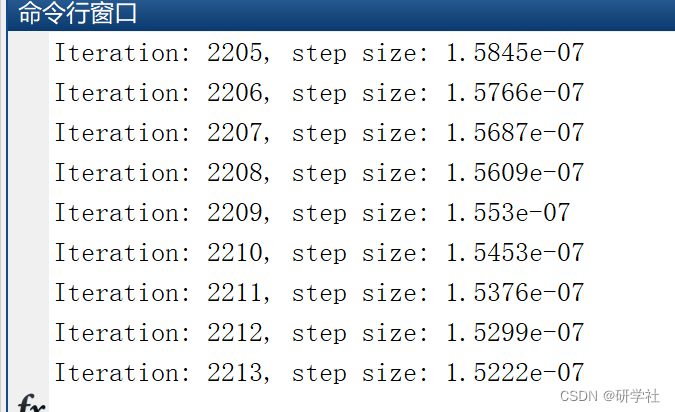
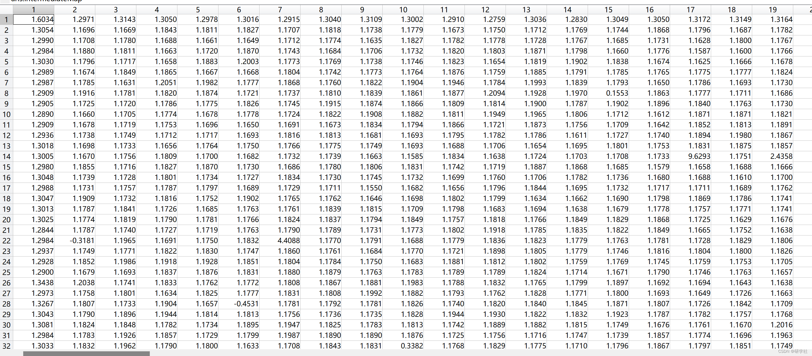

# Multi-layer regression learning based on the radiation transfer model for estimating shadow maps in hyperspectral images (Matlab code implementation)

💥💥💞💞 Welcome to this blog❤️❤️💥💥
🏆 Bloggers' Advantages: 🌞🌞🌞 The content of the blog strives for rigorous thinking and clear logic to facilitate readers.
⛳️ Mantra: A journey of a thousand miles is begun with a single step. 1 Overview📚2 Run-time Results🎉3 References🌈4 Matlab Code and Detailed Articles
💥1 Overview Experience Line Method (ELM) Application in High-Spectral Atmospheric Compensation (AC) establishes a potential linear relationship between material reflectance and appearance. ELM solves the radiation transfer (RT) equation under special constraints using white and black calibration panels within the scene. The material reflectance is independent of illumination. Leveraging this characteristic, we elucidate a mathematical formula based on the RT model to create a cost function related to variable lighting areas in the scene. In this paper, we propose a multi-layer regression learning-based recovery of radiation components, namely the total ground reflected radiation and path radiated intensity from the scene. These decomposed components represent terms in the RT equation, enabling us to associate variable illumination. Therefore, we assume that high-spectral image (HSI) radiation intensity data of the scene is provided and can be processed through AC, preferably using the Quick Atmospheric Correction (QUAC) algorithm. QUAC is preferred as it does not consider surface models. The output of the proposed algorithm is an intermediate map of the scene, and our mathematical derivations apply binary and multi-label thresholds for classifying shadow and non-shadow areas. The results of satellite and airborne NADIR images are presented. Ground truth (GT) is generated by light tracing on a surface model based on LiDAR data, represented as contour lines of the scene. Comparing our results with GT means that our algorithm's binary classification of shadow maps outperforms other existing shadow detection algorithms in terms of true positives, i.e., detecting shadows accurately on ground truth. Compared to existing algorithms, it also has the lowest false negatives, i.e., detecting non-shadow areas as shadows.
​Edit
📚2 Run-time Results​Edit
​Edit Part of the code:
function output = deshadowScene(Radiance, Reflectance)  
clc;  
[h, w, b] = size(Radiance);  
outputWS = estLwLbWholeScene(Radiance, Reflectance); % global  
[Lw_map, Lb_map] = LwLbSlidingWindow(Radiance, Reflectance); % local  
Lw_map = reshape(Lw_map, [h*w, b]);  
Lb_map = reshape(Lb_map, [h*w, b]);  
%% Shadow Detection  
alphaLocal = Lw_map ./ (outputWS.Lw - outputWS.Lb); % equation 11  
alphaGlobal = outputWS.Lw ./ (outputWS.Lw - outputWS.Lb);  
betaLocal = Lb_map ./ (outputWS.Lw - outputWS.Lb); % equation 12  
betaGlobal = outputWS.Lb ./ (outputWS.Lw - outputWS.Lb);  
Reflectance = reshape(Reflectance, [h*w, b]);  
fk = (Reflectance - betaLocal) ./ alphaLocal; % equation 24a  
fg = (Reflectance - betaGlobal) ./ alphaGlobal; % equation 24b  
t = fk ./ fg; % equation 25  
t1 = zeros(h*w, 1);  
for px = 1:h*w  
t1(px) = findF(t(px, :));  
end  
output.intermediateMap = reshape(t1, [h, w]);  
gamma = alphaLocal ./ alphaGlobal; % equation 18a  
delta = (betaLocal - betaGlobal)./betaGlobal; % equation 18b  
Lns = gamma .* reshape(Radiance, [h*w, b]) + delta;  
output.correctedRadiance = reshape(Lns, [h, w, b]);  
end  
🎉3 References
🌈4 Matlab code and detailed article

## Images

<!-- PAYMENT_BLOCK -->

## Get this dataset

- Payment link (Stripe): [Buy now](https://buy.stripe.com/3cs8yP7sY87d0vu9AB)
- Payment QR code: 

<!-- /PAYMENT_BLOCK -->
